# Shortlist

<p align="center">
  <picture>
    <source media="(prefers-color-scheme: dark)" srcset="docs/launch-dark.svg">
    <source media="(prefers-color-scheme: light)" srcset="docs/launch-light.svg">
    
  </picture>
</p>

A calm desktop app for the open-source [ai-job-search](https://github.com/ai-job-search-dev/ai-job-search) workflow. It is a front-end only: your profile, tracker and application folders stay in your own copy of ai-job-search, and every button runs that repo's own commands.

**Status:** early. It connects to your folder and to your own signed-in Claude Code, adds jobs and checks your fit, finds and ranks new jobs, shows your tracker as a board, and records status updates. It also checks this computer for the tools the commands use (Settings › This computer) without installing anything. A first-run wizard connects the AI, checks the computer, picks or sets up your folder and starts building your profile. The Profile screen shows each profile file read-only, with "Update with AI" for the parts the setup command can update. Still to come: API-key engine and the Reports screen.

## Platforms
- **Windows:** tested. The installer is on the [Releases page](https://github.com/HamzaBTW/shortlist-desktop/releases).
- **Linux:** untested; contributors welcome. Releases carry a `.deb` (x64) for Ubuntu, Debian and Mint. Before a release it is only checked to install and start on the build machine, so a release can come without it when that check fails.
  - Install or update: `sudo apt install ./<the downloaded file>.deb`. Remove: `sudo apt remove shortlist`.
  - There is no AppImage: on many systems (Ubuntu 24.04 and newer) it would start with the sandbox switched off.
  - Other Linux systems: build from source with `npm run dist:linux`.
- **macOS:** untested; contributors welcome. Build from source with `npm run dist:mac`.

## Install (Windows)
1. Install what Shortlist needs first. It checks for these and never installs them for you:
   - **Claude Code** 2.1.310 or newer, installed and signed in. Shortlist runs on your own account.
   - **A copy of [ai-job-search](https://github.com/ai-job-search-dev/ai-job-search)** with your profile filled in. Shortlist asks you to pick this folder.
   - **Python 3.10 or newer**, **Bun**, and the **PDF toolkit** (`lualatex`, `xelatex`, the `pypdf` package and Poppler) that ai-job-search itself uses.
2. Download `Shortlist-Setup-<version>.exe` from the [Releases page](https://github.com/HamzaBTW/shortlist-desktop/releases) and run it. It installs for your user only, so it needs no administrator rights. You can pick the folder.
3. Windows may show **"Windows protected your PC"** because this build is not code-signed yet. That warning means "unknown publisher", not "malware found". To continue, choose **More info**, then **Run anyway**. To check the file first, compare its hash with the one in `SHA256SUMS.txt` on the same release: `Get-FileHash .\Shortlist-Setup-<version>.exe -Algorithm SHA256` in PowerShell.
4. Open Shortlist, go to Settings, choose your ai-job-search folder and check that your Claude Code shows as ready.

To remove it, use Windows **Settings > Apps > Shortlist > Uninstall**. Your job-search folder is never touched.

To build the installer yourself: `npm run dist:win` writes `dist/Shortlist-Setup-<version>.exe`.

## Develop
Needs Node 24 or newer.

```
npm install
npm run dev        # run with live reload
npm test           # unit tests
npm run build      # type-check and build
npm run dist:win   # Windows installer (also dist:mac, dist:linux)
```

## How it is put together
- `src/main`: the Electron main process. Opens the window, serves the screens from a private `app://` address, answers the screens' requests.
- `src/preload`: the bridge. The screens get only the functions listed in `src/shared/ipc.ts`.
- `src/renderer`: the screens (React + TypeScript). All text is in `src/renderer/src/locales/`.
- `design/`: copies from the Shortlist design system. `npm run tokens` turns `design/tokens.json` into CSS variables.

## Privacy and safety
- No account, no telemetry, no network port. The screens cannot reach the internet; only the AI engine you connect does.
- The window runs sandboxed with context isolation and a strict content security policy. Pop-ups, navigation away from the app and embedded web views are blocked.
- The app never writes your job-search files itself. The AI commands do, after you approve.

## What runs without asking
Commands run inside your folder through your own Claude Code. By default these go ahead without a card:
- File changes inside your folder (your folder's own protected files still ask). A Settings switch makes every change ask.
- Reading web pages and searching the web. A Settings switch makes each one ask.
- The Indeed connector's `search_jobs` and `get_job_details`, when you have the connector.

These always ask (Allow once / Deny): anything else a command wants to do, and Indeed company details, and only while drafting an application (`/apply`).

These are always refused, whatever the settings: changes outside your folder, uploading to GitHub (`git push`), deleting folders, administrator commands, and reading your résumé on Indeed.

## Job sources
Settings has a number per source (LinkedIn, freehire, Indeed, careers pages; 5 each by default; 0 skips a source) that limits how many postings each adds per search. Postings missing a company, location, description or apply link are listed so you can close them with one click. Indeed cannot load more results, so a source that falls short may stay short.

## Contributing and security
See [CONTRIBUTING.md](CONTRIBUTING.md). Please report security problems privately as described in [SECURITY.md](SECURITY.md), not in a public issue.

## Licence
MIT. Bundled fonts: SIL Open Font License 1.1.
